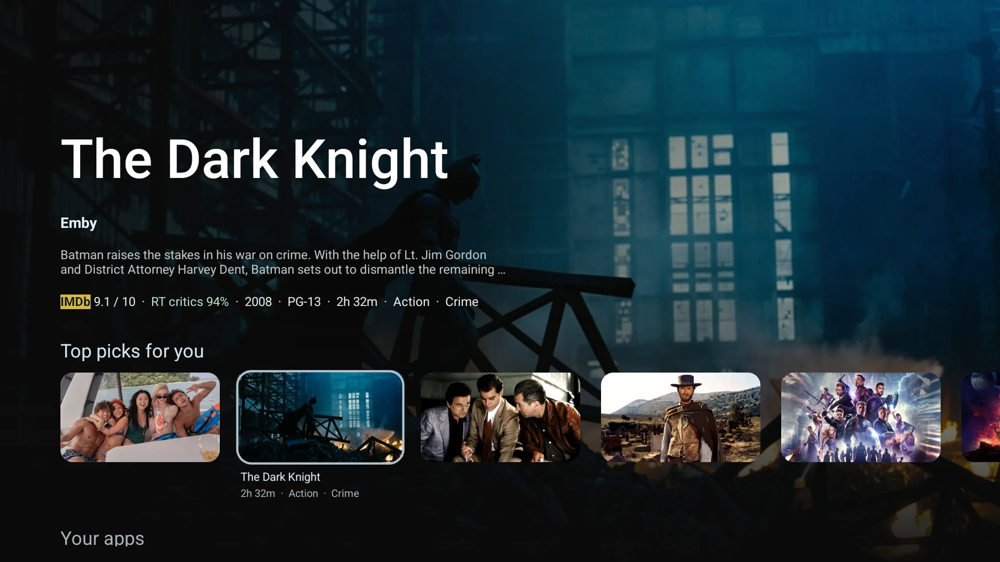

# Vue TV

A personal Android TV launcher with cinematic Emby picks, live Twitch follows, movie and TV requests, and local profiles. Built and tested on a Google TV Streamer running Android 14.

**[Download the latest APK](https://github.com/VueDevOps/VueTV/releases/latest)** ? **[Interactive showcase](https://vuedevops.github.io/VueTV/)** ? **[Setup guide](docs/SETUP.md)**



## Features

- Home, Apps, Live and Requests tabs with remote navigation, focus effects and native navigation sounds.
- Emby Continue watching, Recently added and rotating unwatched picks, with cinematic backgrounds and optional Jellyseerr discoveries.
- Followed live Twitch channels with device-code sign-in.
- Jellyseerr search, discovery, title details, ratings and trailers, with confirmation before requesting movies or TV seasons.
- Up to 12 local profiles with separate sign-ins, app order, preferences and caches; customizable avatars.
- Saved app ordering, configurable artwork caching, and optional Home-button handling.

Vue TV has no advertising feed or analytics SDK. Playback opens installed apps. YouTube and Netflix are shortcuts, without access to their private feeds. Streaming apps keep their own subscription and advertising rules.

## Install and connect

1. Download `VueTV-0.20.0.apk` from [Releases](https://github.com/VueDevOps/VueTV/releases/latest) and sideload it onto your Android TV / Google TV device.
2. Open **Vue TV Preview**, select the avatar, then **VueSettings**.
3. Connect your Emby server, for example `https://emby.example.com`. Connect Twitch with your own public Twitch application's Client ID if wanted.
4. Open **Requests / Sign in** to enter your Jellyseerr URL, for example `https://jellyseerr.example.com`, and Emby credentials.

Example domains are placeholders. There is no included server, media library or shared account. Connections require HTTPS with a trusted certificate. Android 8.0 (API 26) is the build minimum; device-specific launcher and quick-settings behavior has only been checked on the Google TV Streamer. This is preview software.

Read the **[full setup guide](docs/SETUP.md)** for installation, optional Home-button setup, upgrades, troubleshooting and restoring Google TV.

## Build from source

Install JDK 17 or 21 and Android SDK platform 35. Set `ANDROID_HOME` or create an ignored `local.properties` containing `sdk.dir=/path/to/Android/Sdk`. The wrapper downloads Gradle 8.11.1; Android Gradle Plugin is 8.10.1.

```sh
git clone https://github.com/VueDevOps/VueTV.git
cd VueTV
./gradlew :app:assembleDebug :app:lintDebug
```

On Windows use `./gradlew.bat`. The debug APK is `app/build/outputs/apk/debug/app-debug.apk`. See [Development](docs/DEVELOPMENT.md) for signing and validation. A debug build cannot update the signed public APK in place.

## Showcase and support

The complete static showcase, screenshots and recordings are in [`showcase/`](showcase/README.md). GitHub Actions deploys `showcase/dist/` to [GitHub Pages](https://vuedevops.github.io/VueTV/) when its source changes on `main`. It does not access visitors' service accounts.

See [release notes](CHANGELOG.md), [privacy and stored data](docs/PRIVACY.md), and [third-party notices](THIRD_PARTY_NOTICES.md). Report issues with your device, Android version, app version and reproduction steps. Remove credentials and personal server addresses from logs and screenshots.

## License

Vue TV source is available under the [MIT license](LICENSE). Screenshot media, service branding and the bundled font have separate ownership and licensing; see [third-party notices](THIRD_PARTY_NOTICES.md). Vue TV is independent and is not affiliated with Google, Emby, Twitch or Jellyseerr.
